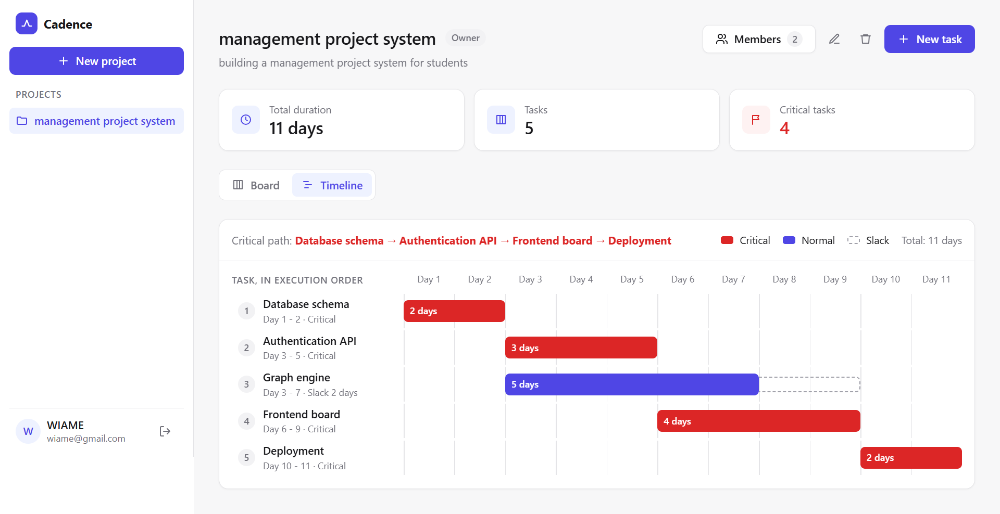
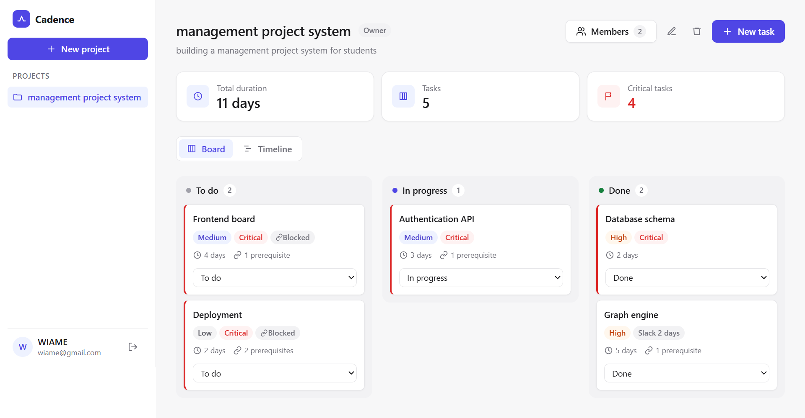
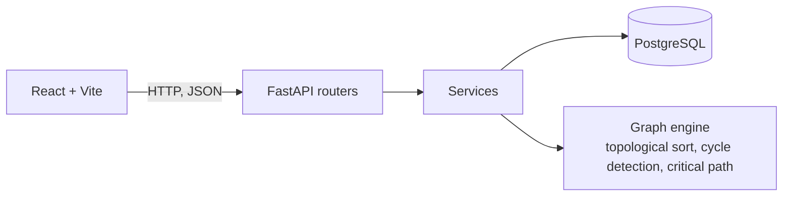

# Cadence


**Project planning for student and small software teams: a task board that knows which tasks decide your deadline.**



## Why Cadence exists

A final-year project, a hackathon or a small team's MVP all have the same shape: a fixed deadline, and tasks that depend on each other. The report waits for the development, the development waits for the specification, the deployment waits for the tests.

Teams usually track this on a chat, a spreadsheet or a Kanban board. A board shows the status of every task, but it does not show what blocks what, and it cannot answer the two questions that matter near a deadline:

- **What is the earliest date we can finish?**
- **Which tasks cannot slip without moving the deadline, and which ones have some room?**

Cadence answers them automatically. You enter tasks, durations and dependencies; Cadence computes the **critical path** (the chain of tasks that sets the end date) and the **slack** of every other task, and shows them on a timeline.

## What you can do

- Create a project, invite teammates by email, and give them a role: **owner** (manages tasks, dependencies and members) or **member** (works on tasks).
- Plan tasks with a priority and a duration in days, and say which tasks must be done first.
- Follow the work on a three-column board: To do, In progress, Done. A task cannot start before its prerequisites are done.
- See the plan on a timeline: the critical path in red, and the slack of each other task as a dashed bar.
- Get a clear error when the plan is impossible: a circular dependency is refused and the tasks that block each other are shown (for example `A -> B -> A`).
- Edit safely as a team: if two people change the same task, the second one is told the task was modified instead of silently overwriting it.

## Example

A project of five tasks:

| Task | Duration | Needs |
|---|---|---|
| Database schema | 2 days | |
| Authentication API | 3 days | Database schema |
| Graph engine | 5 days | Database schema |
| Frontend board | 4 days | Authentication API |
| Deployment | 2 days | Graph engine, Frontend board |

Cadence computes:

- **Total duration: 11 days.**
- **Critical path:** Database schema, Authentication API, Frontend board, Deployment. Any delay on one of these delays the whole project.
- **Graph engine has 2 days of slack:** it can start up to two days late without changing the end date.

## Engineering highlights

| | |
|---|---|
| **Graph algorithms from scratch** | Topological sort (Kahn), cycle detection (DFS) and the Critical Path Method, all O(V + E), in pure Python with no graph library. |
| **Useful cycle errors** | A dependency that would create a cycle is refused *before* anything is saved, and the API returns the tasks that form it (`A -> B -> A`). |
| **Concurrency control** | Optimistic locking: a `PATCH` must send the version it read, and the update runs as `UPDATE ... WHERE id = ? AND version = ?`. If no row is updated, someone else changed the task first and the API answers `409`. |
| **Measured, not assumed** | Reproducible benchmark: 18 ms for a 10,000-task project (in-memory). |
| **Engine isolated from the web layer** | The algorithms are pure functions on dictionaries, so they are unit tested without a database (19 tests, run by GitHub Actions on every pull request). |
| **Reproducible setup** | `docker compose up` starts the API and its PostgreSQL database. |

## The algorithms

A project is a directed graph: tasks are nodes, and an edge goes from a prerequisite to the task that waits for it.

1. **Topological sort (Kahn).** Repeatedly take the tasks with no unfinished prerequisite. If some tasks are never taken, they are stuck in a cycle.
2. **Cycle reporting (DFS).** Only when a cycle exists, a depth-first search with three states (unvisited, visiting, done) finds the exact tasks that form it, so the user sees `A -> B -> A` and not just "invalid".
3. **Critical path (CPM).**
   - *Forward pass:* in topological order, a task starts when its slowest prerequisite finishes (earliest start and finish).
   - *Backward pass:* in reverse order, a task must finish before its most urgent successor starts (latest start and finish).
   - *Slack* = latest start - earliest start. Tasks with zero slack are critical: any delay on them delays the whole project.

## Screenshots



## Run it

Requires Docker Desktop and Node.js.

```bash
docker compose up --build
```

The API starts on http://localhost:8000/docs, with its own PostgreSQL database (empty at first). Then, in another terminal:

```bash
cd frontend
npm install
npm run dev
```

Open http://localhost:5173, create an account, and create your first project.

## How it works



**The graph engine** (`app/services/`) turns a project into a directed graph and does not depend on the database or on FastAPI:

| File | Role |
|---|---|
| `graph_service.py` | reads the tasks and dependencies of a project and builds the graph |
| `topological_sort.py` | Kahn's algorithm gives a valid order; if there is a cycle, a DFS finds the tasks that form it |
| `critical_path.py` | forward pass, backward pass, slack, critical tasks |

**Performance.** Benchmark of the engine (sort + critical path) on random acyclic graphs, each task depending on 0 to 3 earlier tasks:

| Tasks | Dependencies | Best time |
|---|---|---|
| 100 | 140 | 0.1 ms |
| 1,000 | 1,510 | 1.6 ms |
| 10,000 | 14,899 | 18.3 ms |
| 100,000 | 149,495 | 404.5 ms |

These timings are consistent with O(V + E). They measure the in-memory computation only (no database, no network), on a personal laptop with Python 3.14 and a fixed random seed. To reproduce: `uv run python -m benchmarks.engine_benchmark`.

**API.** The interactive documentation is at `/docs`. The main routes: `/token` and `/users` (authentication), `/projects` and `/project` (projects), `/projects/{id}/members`, `/projects/{id}/tasks`, `/tasks/{id}/dependencies`, `/projects/{id}/schedule` (valid task order) and `/projects/{id}/critical-path` (duration, critical tasks, dates and slack).

## Tests

19 unit tests cover the graph engine: topological order, isolated tasks, full and partial cycles, critical path, slack, and what happens when a task is delayed. A GitHub Actions workflow runs them on every pull request.

```bash
cp .env.example .env
uv run pytest
```

## Stack

Python, FastAPI, SQLAlchemy (async), PostgreSQL, Alembic, Pydantic, JWT, Argon2, pytest, Docker Compose, GitHub Actions. Frontend: React and Vite, in plain JavaScript and CSS (no UI library).